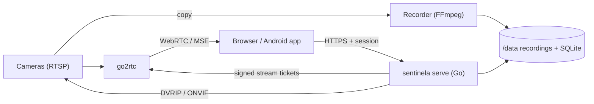

<div align="center">


# Sentinela

**A self-hosted home NVR that runs on an old PC.**
Live view, 24/7 recording, events and object detection, a file server and an
Android app, in one small Go binary next to go2rtc and FFmpeg.

[](https://github.com/LUKER2DW/Sentinela/actions/workflows/ci.yml)
[](https://github.com/LUKER2DW/Sentinela/releases)
[](LICENSE)
[](go.mod)

[Features](#features) · [Screenshots](#screenshots) · [Quick start](#quick-start) · [Cameras](#supported-cameras) · [Detection](#motion-and-object-detection) · [Android app](#android-app) · [Docs](#documentation) · [Contributing](CONTRIBUTING.md)

<picture>
  <source media="(prefers-color-scheme: dark)" srcset="docs/images/live-grid-dark.jpg" />
  
</picture>

</div>

---

## Why Sentinela

Most NVRs either need a strong machine to re-encode video or push your
cameras to someone else's cloud. Sentinela does neither:

- **Copy, never transcode.** H.265/H.264 video goes from the camera to disk
  and to your browser as-is, so a decade-old CPU without hardware decoding
  keeps up.
- **Recording comes first.** Recorders are supervised FFmpeg processes that
  pull straight from the cameras. If the web app, the database or go2rtc
  crash, recording continues.
- **Your house, your data.** Everything stays on your server and LAN.
  Remote access is Tailscale, or one opt-in TLS listener that shows nothing
  but a login page to strangers.
- **Small.** One Go binary (≤ 80 MB RAM), go2rtc and FFmpeg. SQLite, no
  Postgres, Redis or message queue.

## Features

**Cameras and live view**
- Any number of cameras: XMEye/Xiongmai, Hikvision, Dahua, or any RTSP
  camera. For ONVIF cameras the editor finds the stream addresses by itself.
- Each camera says what it has (PTZ, white light, speaker): the live page
  shows only those controls ([docs/CAMERAS.md](docs/CAMERAS.md)).
- Low-latency live view over WebRTC, with MSE as fallback; main and sub
  streams, grids, full screen, push-to-talk on cameras with a speaker.
- PTZ with press-and-hold controls, saved positions, **preset tours**, white
  light and day/night mode (XMEye, over an allow-listed DVRIP driver).
- A first-run setup guide: cameras, recording, file share, self-hosted
  services, remote access, the app and two-step login. Every step can be
  skipped, and what you skip stays out of the menu.

**Recording and review**
- 24/7 copy-only recording in 5-minute fragmented MP4 files.
- Timeline with hover previews, events, export of any range, timelapses.
- Fills the disk and overwrites the oldest, or keeps a fixed number of
  days; alerts can be kept longer; protect important clips.
- Pauses instead of filling the system disk if the recordings disk does not
  mount.

**Events, detection and notifications**
- Motion from the camera's ONVIF events or, for cameras that send none
  (RTSP only), from the video; tamper alarms; and optional object detection
  with **YOLO26n** (people, vehicles, animals) on sub-stream keyframes, only
  while there is motion and inside zones you draw
  ([how it works](#motion-and-object-detection)).
- Review queue with snapshots, unseen markers and severities.
- Web push and Android notifications, per user, with home/away modes and
  an automatic night schedule.

**Cloud: the house file server**
- SMB share for the LAN and a web/mobile file browser with uploads,
  previews, a recycle bin and per-user folders.

**Accounts and security**
- Admin, operator and viewer roles, per-camera visibility, invite codes,
  optional TOTP two-step login, device sessions you can revoke, audit log.
- Hardened by default: see [SECURITY.md](SECURITY.md).

**Extras**
- Android app (Capacitor): one APK for every house, paired by QR code, with
  notifications, an app lock and in-app updates.
- Optional **self-hosted services**: run your own projects from GitHub or a
  Cloud folder (script, Dockerfile or Compose) as capped, isolated
  containers next to the NVR.
- Nightly database/config backups, optional restic copy, and a restore
  drill.

## Screenshots

<table>
  <tr>
    <td width="50%"><br /><sub><b>One camera.</b> Press-and-hold PTZ, saved positions, light and day/night, and today's timeline. Cameras without PTZ or a light do not show those controls.</sub></td>
    <td width="50%"><br /><sub><b>Settings in the browser.</b> Cameras, recording, time zone and disks, validated and rolled back on failure. Passwords stay on the server.</sub></td>
  </tr>
  <tr>
    <td width="50%"><br /><sub><b>First-run guide.</b> After the admin account, a short tour sets up the rest. Every step can be skipped.</sub></td>
    <td width="50%"><br /><sub><b>Cameras of any brand.</b> ONVIF finds the streams; Hikvision, Dahua and XMEye have presets; any other RTSP camera works with its paths.</sub></td>
  </tr>
  <tr>
    <td width="50%"><br /><sub><b>Only what you use.</b> Cloud and self-hosted services are optional; skip them and their tabs stay hidden.</sub></td>
    <td width="50%"><br /><sub><b>Remote access, your choice.</b> Home only, Tailscale, or one HTTPS port, explained in place.</sub></td>
  </tr>
  <tr>
    <td width="50%"><br /><sub><b>One app for every house.</b> Point the phone at a QR code; the app checks the house's certificate.</sub></td>
    <td width="50%" align="center"><br /><sub><b>On the phone.</b> The same pages, laid out for one hand.</sub></td>
  </tr>
</table>

The interface is in English and Brazilian Portuguese, picked from the
device, with light, dark and automatic themes and six colour palettes. The
camera pictures in these screenshots are stock photos
([credits](NOTICE)), not a real installation.

## How it works



| Component | Role |
|---|---|
| `sentinela serve` | API, accounts, web app, camera control, events, file server |
| `sentinela record` | One supervised FFmpeg per camera, segment index, retention |
| go2rtc | Live media: RTSP in, WebRTC/MSE out, two-way audio |
| detector (optional) | Object detection on sub-stream keyframes, gated by motion |
| apps agent (optional) | Self-hosted services; the only part that talks to Docker |

Details: [docs/ARCHITECTURE.md](docs/ARCHITECTURE.md).

## Requirements

| Part | Minimum |
|---|---|
| Server | x86-64, 2 cores (no HEVC hardware decode needed), 1 GB RAM for up to about 3 cameras with detection; 2 GB for more cameras or self-hosted services |
| OS | Ubuntu Server 22.04+ or Debian 12+, with Docker |
| Disks | A dedicated disk for recordings at `/data`; optional disks for the file share and backups |
| Cameras | RTSP (H.264/H.265), ONVIF recommended; XMEye cameras also get PTZ and light control |
| Network | Wired LAN; fixed addresses (DHCP reservations) for the server and cameras |

Measured with one camera and detection on, the whole server (OS, Docker,
Tailscale, file share and Sentinela) uses about 520 MB of RAM and under 5 %
of one core; each extra camera adds roughly 60–100 MB. One stream at
~2 Mbit/s writes about 20 GB per day.

## Quick start

On the server, with the recordings disk mounted at `/data`:

```bash
sudo git clone https://github.com/LUKER2DW/Sentinela.git /opt/sentinela
cd /opt/sentinela
sudo ./scripts/install-server.sh
```

1. The installer sets up Docker, the firewall and `/etc/sentinela/`
   (`config.yaml` and the root-only `secrets.env`), starts the containers
   and prints the address.
2. Open `http://<server>:8080`. The first visit creates the admin account.
3. The setup guide adds the cameras and walks through recording, the file
   share, remote access and the app.

The full guide, from preparing the camera to remote access, backups and
troubleshooting, is **[docs/INSTALL.md](docs/INSTALL.md)**.

Prefer not to build anything? Each [release](https://github.com/LUKER2DW/Sentinela/releases)
publishes the server image `ghcr.io/luker2dw/sentinela` with an SBOM and
build provenance, a Linux binary and the signed Android app, which your
server then offers to the phones by itself
([docs/RELEASING.md](docs/RELEASING.md#using-a-published-image-on-a-server)).

## Supported cameras

| | Any RTSP camera | With ONVIF | XMEye / Xiongmai |
|---|:---:|:---:|:---:|
| Live view, 24/7 recording, timeline, export | ✓ | ✓ | ✓ |
| Streams found automatically | – | ✓ | ✓ (preset) |
| Motion events | ✓ (from the video) | ✓ | ✓ |
| Tamper events | – | ✓ | ✓ |
| Object detection | ✓ | ✓ | ✓ |
| PTZ, positions, tours, white light, day/night | – | – | ✓ |
| Two-way audio | if it has a speaker | if it has a speaker | ✓ |

Hikvision and Dahua/Amcrest also have stream presets. Stream paths for
common brands and per-camera features are in [docs/CAMERAS.md](docs/CAMERAS.md).

## Motion and object detection

The camera's own motion detection fires on trees, shadows, rain and
headlights. Sentinela uses it only as a trigger, and an object detector
decides whether the motion matters.

1. **Motion wakes it.** The camera reports motion over ONVIF. While nothing
   moves, the detector only reads the sub stream from go2rtc without
   decoding it, so it costs almost nothing. A camera that sends no motion
   events (RTSP only, or ONVIF events that stopped) gets motion from the
   video instead (below).
2. **Keyframes only.** While motion lasts, and for 10 s after it ends, each
   keyframe of the sub stream (about one every 2 s) is decoded and analysed,
   including the keyframe just before the motion began. The main stream is
   never decoded.
3. **YOLO26n looks for objects.** People, vehicles (bicycle, car,
   motorcycle, bus, truck) and animals (cat, dog).
4. **Zones decide.** An object counts when the bottom centre of its box (the
   feet or the wheels) is inside a zone that watches its kind. With zones,
   only the area around them is analysed, enlarged for small objects.
   Without zones, the whole picture watches people.
5. **Steady, not jumpy.** With sensitivity *s* (High 0.35, Normal 0.45,
   Low 0.6), one frame at *s* + 0.15, or two of the last three at
   *s* − 0.1, start an event; *s* − 0.1 keeps it going. It ends after 12 s
   without the object. Something that stays in the same place stops counting
   (vehicles after 30 s, animals after 60 s, people after 5 min), so a
   parked car does not keep alerting.
6. **One alert, with a picture.** A person is an alert; vehicles and
   animals are detections. The analysed frame becomes the event snapshot.
   While the detector is healthy, plain motion stays on the timeline but no
   longer notifies.

The live view can draw the boxes over the picture, and the zone editor shows
whether each object would count before you save.

| | |
|---|---|
| Model | [YOLO26n](https://docs.ultralytics.com/models/yolo26/) by Ultralytics, nano size (2.4 M parameters, 40.9 mAP on COCO) |
| Weights | `yolo26n.pt` from Ultralytics assets v8.4.0, pinned by SHA-256 and downloaded while the image builds |
| Export | ONNX, opset 17, 640×352 input (the sub stream's 16:9, no padding), with Ultralytics 8.4.165 in a build-only stage |
| Runtime | ONNX Runtime 1.23.2 on the CPU, one thread; PyAV 18.1.0 for RTSP and HEVC; NumPy 2.5.3; Python 3.12 |
| Cost | About 0.3 s per analysis, ~15 % of one core while something moves, almost nothing when idle |
| Limits | Lowest CPU priority (`cpu_shares: 128`, one-core ceiling), 192 MB of memory, read-only, no capabilities |

Good to know:

- A person who crosses the picture in under 2 s can fall between two
  keyframes, and the sub stream's resolution limits how far away an object
  can be seen.
- **Motion from the video.** For a camera that sends no motion events, the
  detector decodes each sub-stream keyframe, shrinks it to a 64×36 grey
  picture and compares it with a slowly updated background. Enough change
  (inside the zones, when there are any) opens a motion event, with a
  snapshot, and wakes the object detection as above. A change across the
  whole picture (the IR switching on, a cloud) and the camera's own PTZ
  moves do not count. It costs about 2.3 % of one core per camera, measured
  on the minimum host. System → Cameras → *Motion detection* chooses:
  Automatic (the default: the camera's events while they flow, the video
  otherwise), From the camera, or From the video.
- Recording and the API never depend on the detector: if it stops, the
  camera keeps recording and plain motion alerts come back.
- The YOLO26 weights are AGPL-3.0. They are not in this repository: the
  image build downloads and exports them, and the repository stays MIT.

Design, measurements and the models that were compared:
[ADR-0016](docs/adr/0016-server-person-detector.md).

## Android app

One APK works with every Sentinela server. Install it from a
[release](https://github.com/LUKER2DW/Sentinela/releases), or from your own
server, which offers it in System → App. Then connect it to your house:

1. On a computer, open **System → App**. It shows one QR code per way into
   the house: Tailscale and, if you set it up, the public HTTPS address.
2. Open the app and point the phone's camera at a code, or paste the
   pairing code. The app shows the address and asks before connecting.
3. Sign in as on the web.

The code carries the address and, for a self-signed certificate, its
fingerprint, so the app talks to exactly that server and nothing else. The
app remembers every way into the house and switches by itself when you
leave home. With neither Tailscale nor a public address, it works on the
home network or over your own VPN.

Notifications reach the phone through **your own** Firebase project: put its
`google-services.json` and a service-account key in `/data/fcm/` on the
server and the app picks them up; the APK carries no project of its own.
Without Firebase the app keeps a direct connection to the house
([INSTALL §9–10](docs/INSTALL.md#9-notifications)).

## Configuration

Settings live in `/etc/sentinela/config.yaml`; passwords live only in
`/etc/sentinela/secrets.env` and are referenced by name. Every option is
documented in [deploy/config.example.yaml](deploy/config.example.yaml).

<details>
<summary>Example <code>config.yaml</code></summary>

```yaml
timezone: Europe/Lisbon
recording:
  max_disk_percent: 95        # overwrite the oldest above this
  default_retention_days: 0   # 0 = until the disk is full
cameras:
  - id: front
    name: Front door
    host: 192.168.1.20
    vendor: xmeye             # xmeye | hikvision | dahua | generic
    user_env: FRONT_USER      # names of the variables in secrets.env
    password_env: FRONT_PASS
  - id: yard
    host: 192.168.1.31
    vendor: generic
    rtsp_main: /stream1
    rtsp_sub: /stream2
    user_env: YARD_USER
    password_env: YARD_PASS
```

</details>

Add cameras with `scripts/add-camera.sh` (it validates the config and keeps
a backup), or edit the file and run `./scripts/deploy.sh`. go2rtc's stream
list is generated from this file, so there is nothing else to keep in sync.

| Topic | Where |
|---|---|
| Remote access (Tailscale, public HTTPS) | [INSTALL §8](docs/INSTALL.md#8-remote-access) |
| Notifications and the Android app | [INSTALL §9–10](docs/INSTALL.md#9-notifications) |
| Object detection | [Motion and object detection](#motion-and-object-detection), [ADR-0016](docs/adr/0016-server-person-detector.md) |
| Self-hosted services | [INSTALL §13](docs/INSTALL.md#13-self-hosted-services-optional) |
| Backups and the restore drill | [INSTALL §14](docs/INSTALL.md#14-backups) |

## Updating

From your computer, with Docker running:

```bash
mkdir -p ~/.sentinela
echo 'SENTINELA_HOST=you@192.168.1.10' > ~/.sentinela/deploy.env
./scripts/deploy.sh             # everything
./scripts/deploy.sh --services  # web app and API only; recorders keep running
```

The script builds the images locally, sends them over SSH, restarts the
stack and waits for the health check. The server never needs Go or Node.

Or let the server follow releases on its own, once a day in a quiet hour,
with automatic rollback:
`sudo /opt/sentinela/scripts/setup-auto-update.sh enable 04:00`
([INSTALL §11](docs/INSTALL.md#11-updating)). System → Updates shows
the schedule and what changed in each version.

## Development

<details>
<summary>Run it locally</summary>

```bash
cp deploy/config.example.yaml dev-config.yaml   # git-ignored
# set data_dir to a local folder, recording.volume_marker: none,
# and export the camera variables it names (e.g. CAM1_USER, CAM1_PASS)
cd web && npm ci && npm run build && cd ..
go run ./cmd/sentinela serve -config ./dev-config.yaml
cd web && npm run dev            # Vite on :5173, proxied to :8080
make check                       # go vet, tests, staticcheck, lint, web tests
```

</details>

Requirements: Go (version in `go.mod`), Node.js 22. The Android app is in
`mobile/` (JDK 21 and the Android SDK; see
[INSTALL §10](docs/INSTALL.md#10-android-app)).

Read [AGENTS.md](AGENTS.md) before contributing: it lists the hard rules
(no transcoding, recording independence, resource budgets, secrets) and the
conventions. Changes are small, one concern per commit, with
[Conventional Commits](https://www.conventionalcommits.org/).

## Contributing

Issues and pull requests are welcome. Please read
[CONTRIBUTING.md](CONTRIBUTING.md) first: Sentinela has a few hard rules
(no transcoding, recording first, a small footprint) that keep it running on
old hardware. Security reports go to the **Security** tab, see
[SECURITY.md](SECURITY.md).

## Documentation

| Document | Contents |
|---|---|
| [docs/INSTALL.md](docs/INSTALL.md) | Installation, updates, operations, troubleshooting |
| [docs/ARCHITECTURE.md](docs/ARCHITECTURE.md) | Components, flows, ports and storage |
| [docs/SECURITY.md](docs/SECURITY.md) | Threat model and security rules |
| [docs/CAMERAS.md](docs/CAMERAS.md) | Supported cameras, stream presets and per-camera features |
| [docs/CAMERA.md](docs/CAMERA.md) | XMEye protocol facts and the allow-listed commands |
| [docs/adr/](docs/adr/) | Architecture decision records |
| [docs/RELEASING.md](docs/RELEASING.md) | Versions, published images and the APK |
| [CHANGELOG.md](CHANGELOG.md) | What changed in each version |
| [AGENTS.md](AGENTS.md) | Rules for contributors and coding agents |

## License

[MIT](LICENSE). Third-party notices are in [NOTICE](NOTICE). The optional
detector downloads the YOLO model weights (AGPL-3.0) at build time; they
are not part of this repository.

Sentinela is not affiliated with any camera vendor. Use it where recording
is legal, and respect your neighbours' privacy.
