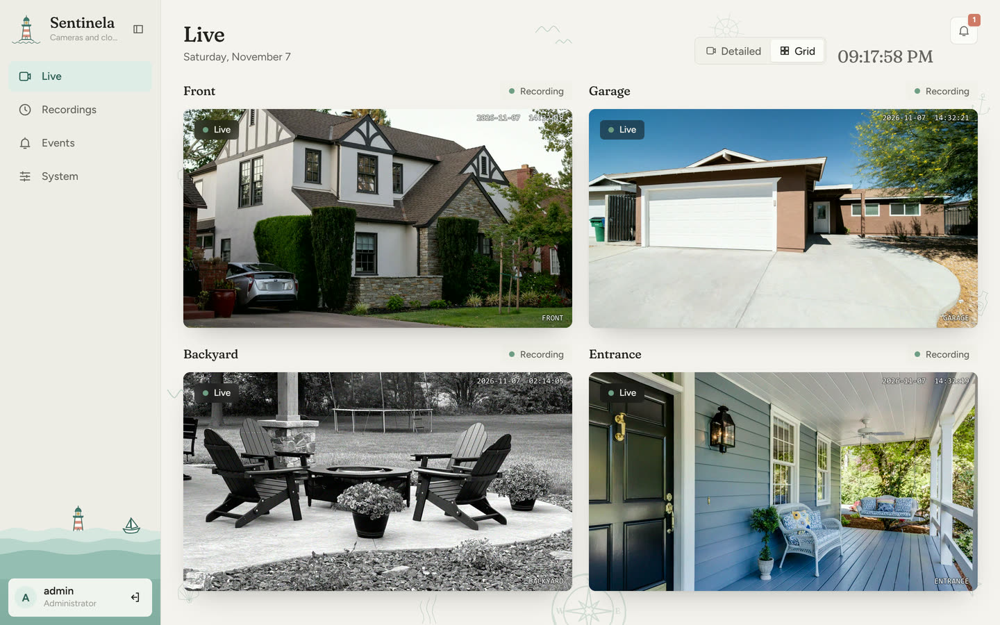
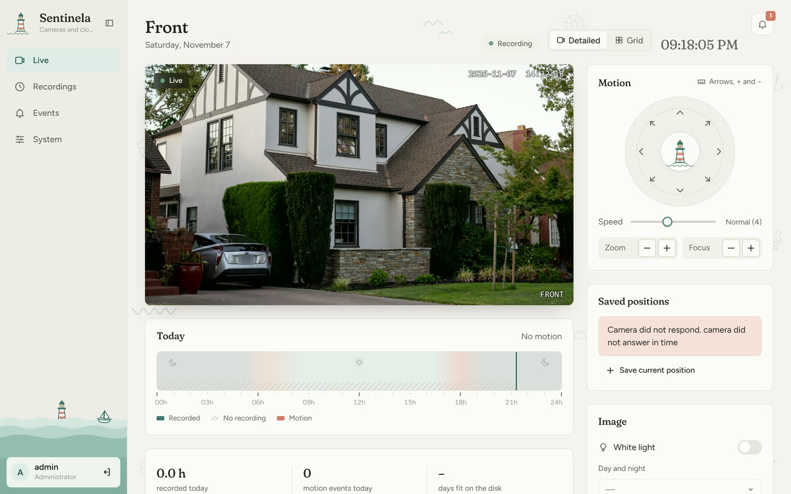
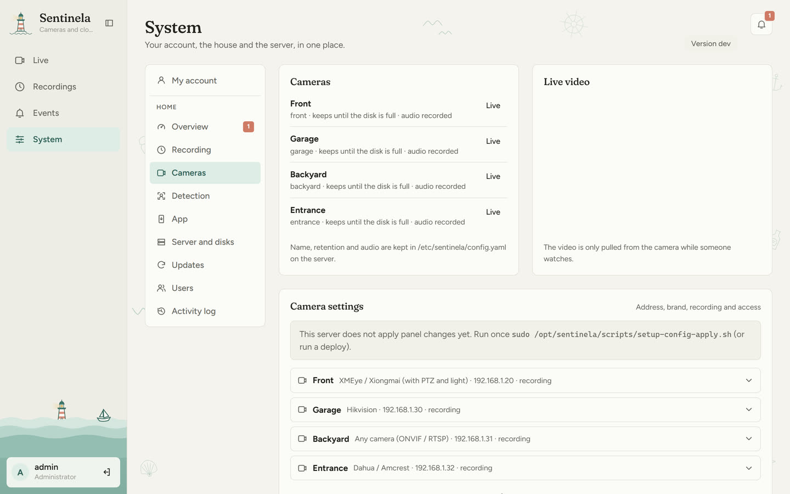
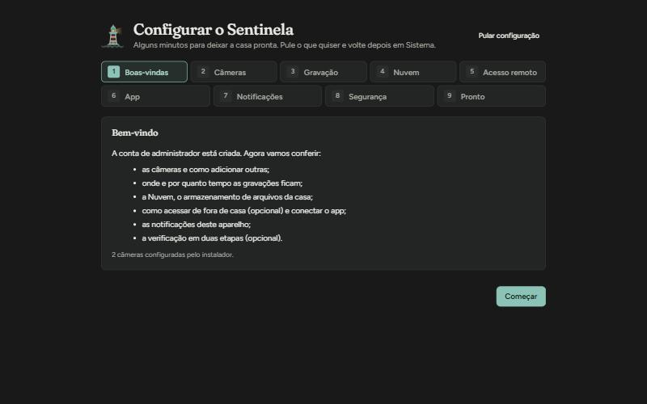
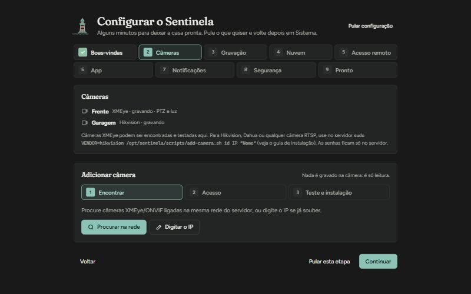
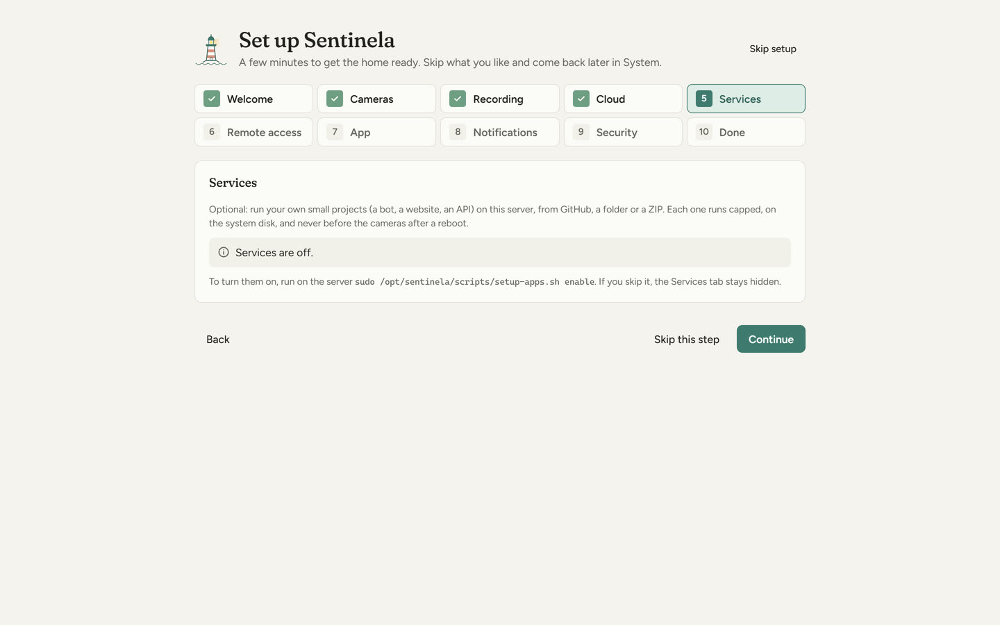
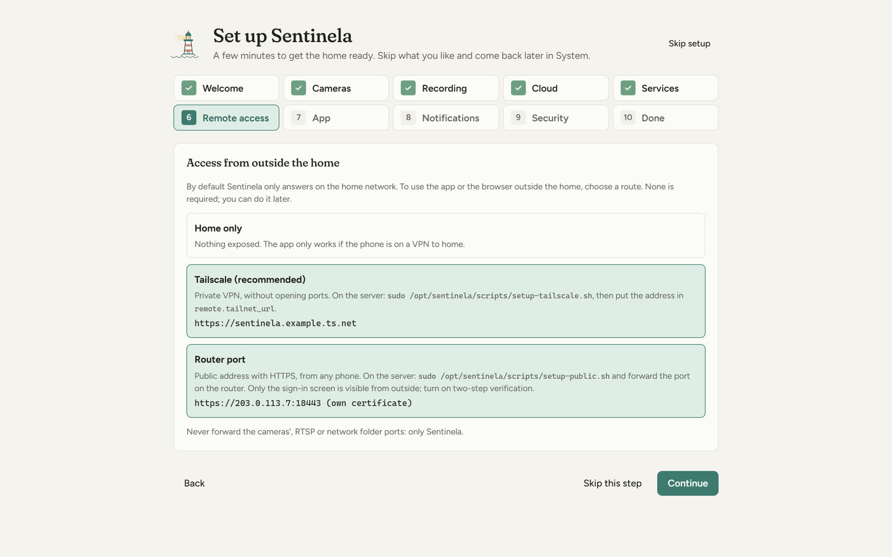
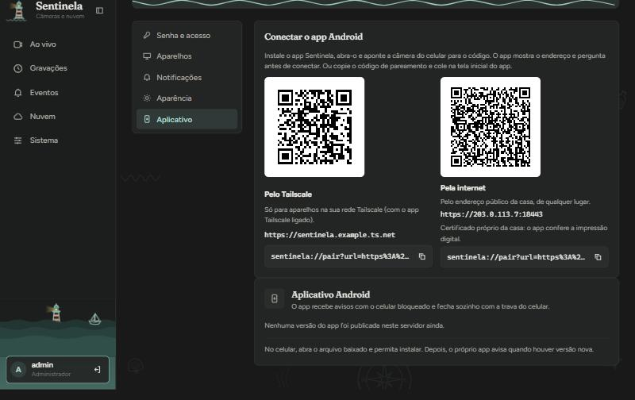
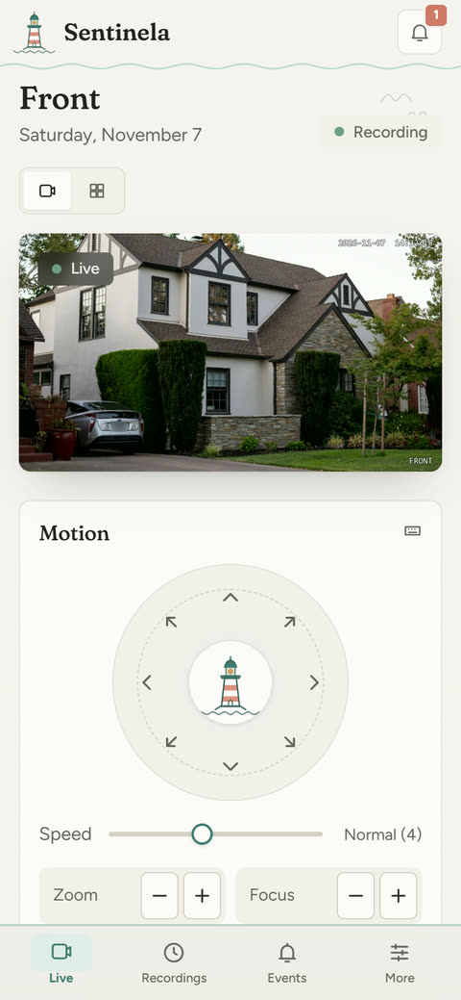
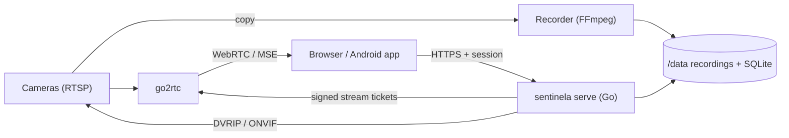

<div align="center">


# Sentinela

### The home NVR that runs on the PC in your closet

Any RTSP or ONVIF camera · 24/7 recording without transcoding · low-latency live view<br />
object detection · a file server for the house · one Android app for every home

[](https://github.com/LUKER2DW/Sentinela/actions/workflows/ci.yml)
[](https://github.com/LUKER2DW/Sentinela/releases)
[](LICENSE)
[](go.mod)


**[Quick start](#quick-start)** · [Features](#features) · [Screenshots](#screenshots) · [Cameras](#cameras) · [Android app](#android-app) · [Docs](#documentation)

<br />

<picture>
  <source media="(prefers-color-scheme: dark)" srcset="docs/images/live-grid-dark.jpg" />
  
</picture>

</div>

<br />

## At a glance

<table>
  <tr>
    <td width="33%" valign="top">
      <h3>🖥️ Runs on little</h3>
      x86-64, 2 cores, <b>1 GB RAM</b>. The whole server, with one camera and detection on, uses about 520 MB and under 5&nbsp;% of a core.
    </td>
    <td width="33%" valign="top">
      <h3>🎞️ Never re-encodes</h3>
      H.264/H.265 goes from the camera to the disk and to your screen as-is. No GPU, no hardware decode needed.
    </td>
    <td width="33%" valign="top">
      <h3>🏠 Stays at home</h3>
      No cloud account. Remote access over Tailscale, or one HTTPS port that shows strangers only a sign-in page.
    </td>
  </tr>
  <tr>
    <td valign="top">
      <h3>⏺️ Recording first</h3>
      Recorders are supervised FFmpeg processes pulling straight from the cameras. If the web app or database stops, recording goes on.
    </td>
    <td valign="top">
      <h3>📷 Any camera</h3>
      ONVIF finds the streams by itself; Hikvision, Dahua and XMEye have presets; anything with RTSP works.
    </td>
    <td valign="top">
      <h3>📱 One app</h3>
      One signed Android APK for every house, paired by QR code, with notifications from your own Firebase project.
    </td>
  </tr>
</table>

## Features

| Area | What you get |
|---|---|
| **Live view** | WebRTC with MSE fallback, main and sub streams, grids and full screen, zoom, a delay meter. Push-to-talk on cameras with a speaker. |
| **Camera control** | PTZ with press-and-hold, saved positions and **preset tours**, white light and day/night (XMEye, over an allow-listed DVRIP driver). Each camera declares what it has; missing controls are hidden. |
| **Recording** | 24/7 copy-only recording in 5-minute fragmented MP4. Fill the disk and overwrite the oldest, or keep a set number of days; keep alerts longer; protect clips. Pauses instead of filling the system disk if the recordings disk is missing. |
| **Review** | Timeline with hover previews, events on the timeline, export of any range, timelapses. |
| **Events and detection** | ONVIF motion and tamper alarms; optional object detection (people, vehicles, animals) on sub-stream keyframes, inside zones you draw; a review queue with snapshots. |
| **Notifications** | Web Push and the Android app, per user, with home/away modes and a night schedule. |
| **Cloud** | The house file server: an SMB share for the LAN and a web/phone file browser with uploads, previews, per-user folders and a recycle bin. Optional. |
| **Self-hosted services** | Run your own projects (a bot, a site, an API) from GitHub, a folder or a ZIP as capped, isolated containers next to the NVR. Optional. |
| **Accounts** | Admin, operator and viewer roles, per-camera visibility, invites, optional TOTP two-step login, revocable device sessions, an activity log. |
| **Operations** | A first-run guide, settings edited in the browser with validation and rollback, nightly backups with a restore drill, and optional automatic updates from releases with rollback. |

The interface speaks **English and Brazilian Portuguese** (picked from the
device), with light, dark and automatic themes and six colour palettes.

## Screenshots

<table>
  <tr>
    <td width="50%"><br /><sub><b>One camera.</b> Press-and-hold PTZ, saved positions, light and day/night, and today's timeline.</sub></td>
    <td width="50%"><br /><sub><b>Settings in the browser.</b> Cameras, recording, time zone and disks, validated and rolled back on failure. Passwords stay on the server.</sub></td>
  </tr>
  <tr>
    <td width="50%"><br /><sub><b>First-run guide.</b> After the admin account, a short tour sets up the rest. Every step can be skipped.</sub></td>
    <td width="50%"><br /><sub><b>Cameras of any brand.</b> ONVIF finds the streams; presets for Hikvision, Dahua and XMEye; RTSP paths for the rest.</sub></td>
  </tr>
  <tr>
    <td width="50%"><br /><sub><b>Only what you use.</b> Cloud and self-hosted services are optional; skip them and their tabs stay hidden.</sub></td>
    <td width="50%"><br /><sub><b>Remote access, your choice.</b> Home only, Tailscale, or one HTTPS port, explained in place.</sub></td>
  </tr>
  <tr>
    <td width="50%"><br /><sub><b>One app for every house.</b> Point the phone at a QR code; the app checks the house's certificate.</sub></td>
    <td width="50%" align="center"><br /><sub><b>On the phone.</b> The same pages, laid out for one hand.</sub></td>
  </tr>
</table>

<sub>The camera pictures are stock photos (<a href="NOTICE">credits</a>), not a real installation.</sub>

## Quick start

You need an x86-64 PC with **Ubuntu Server 22.04+ or Debian 12+** and a
**dedicated disk for recordings mounted at `/data`**.

```bash
sudo git clone https://github.com/LUKER2DW/Sentinela.git /opt/sentinela
cd /opt/sentinela
sudo ./scripts/install-server.sh
```

1. The installer sets up Docker, the firewall and the config, starts the
   stack and prints the address.
2. Open `http://<server>:8080`. The first visit creates the admin account.
3. The setup guide adds your cameras and walks through recording, the file
   share, remote access and the app.

The full guide, from preparing the cameras to backups and troubleshooting,
is **[docs/INSTALL.md](docs/INSTALL.md)**.

> [!TIP]
> Prefer not to build? Every [release](https://github.com/LUKER2DW/Sentinela/releases)
> publishes the server image `ghcr.io/luker2dw/sentinela`, a Linux binary and
> the signed Android app ([docs/RELEASING.md](docs/RELEASING.md#using-a-published-image-on-a-server)).

## Cameras

| | Any RTSP camera | With ONVIF | XMEye / Xiongmai |
|---|:---:|:---:|:---:|
| Live view, 24/7 recording, timeline, export | ✅ | ✅ | ✅ |
| Streams found automatically | – | ✅ | ✅ preset |
| Motion and tamper events | – | ✅ | ✅ |
| Object detection (people, vehicles, animals) | ✅ | ✅ | ✅ |
| PTZ, saved positions, tours, white light, day/night | – | – | ✅ |
| Two-way audio | ✅ if it has a speaker | ✅ if it has a speaker | ✅ |

Hikvision and Dahua/Amcrest have stream presets too. Details, stream paths
for common brands and per-camera features: **[docs/CAMERAS.md](docs/CAMERAS.md)**.

## How it works



| Component | Role |
|---|---|
| `sentinela serve` | API, accounts, web app, camera control, events, file server |
| `sentinela record` | One supervised FFmpeg per camera, segment index, retention |
| go2rtc | Live media: RTSP in, WebRTC/MSE out, two-way audio |
| detector (optional) | Object detection on sub-stream keyframes, gated by motion |
| apps agent (optional) | Self-hosted services; the only part that talks to Docker |

Everything is copy-only, and the browser never reaches go2rtc or a camera
directly, only through short-lived tickets signed by the API. Details:
[docs/ARCHITECTURE.md](docs/ARCHITECTURE.md).

## Requirements

| | Minimum | Comfortable |
|---|---|---|
| **CPU** | x86-64, 2 cores, no hardware video decode | any newer |
| **RAM** | 1 GB (up to about 3 cameras with detection) | 2 GB for more cameras or self-hosted services |
| **OS** | Ubuntu Server 22.04+ or Debian 12+, with Docker | |
| **Disks** | One dedicated disk for recordings at `/data` | Extra disks for the file share and backups |
| **Cameras** | RTSP, H.264 or H.265 | ONVIF on, sub stream enabled |
| **Network** | Wired LAN, fixed addresses for the server and cameras | |

Each extra camera adds roughly 60–100 MB of RAM. One stream at ~2 Mbit/s
writes about 20 GB per day.

## Android app

One APK works with every Sentinela server. Install it from a
[release](https://github.com/LUKER2DW/Sentinela/releases), or from your own
server, which offers it in **System → App**. Then connect it to your house:

1. On a computer, open **System → App**. It shows one QR code per way into
   the house: Tailscale and, if you set it up, the public HTTPS address.
2. Open the app and point the phone's camera at a code, or paste the
   pairing code. The app shows the address and asks before connecting.
3. Sign in as on the web.

The code carries the address and, for a self-signed certificate, its
fingerprint, so the app talks to exactly that server and nothing else. It
remembers every way into the house and switches by itself when you leave
home. Without Tailscale or a public address it works on the home network or
over your own VPN.

Notifications come through **your own** Firebase project: put its
`google-services.json` and a service-account key in `/data/fcm/` on the
server and the app picks them up. The APK carries no project of its own;
without Firebase it keeps a direct connection to the house
([INSTALL §9–10](docs/INSTALL.md#9-notifications)).

## Configuration

Most settings are edited in the browser (**System**). They live in
`/etc/sentinela/config.yaml`; passwords live only in the root-only
`/etc/sentinela/secrets.env`. Every option is documented in
[deploy/config.example.yaml](deploy/config.example.yaml).

<details>
<summary><b>Example <code>config.yaml</code></b></summary>

```yaml
timezone: Europe/Lisbon
recording:
  max_disk_percent: 95        # overwrite the oldest above this
  default_retention_days: 0   # 0 = until the disk is full
cameras:
  - id: front
    name: Front door
    host: 192.168.1.20
    vendor: xmeye             # xmeye | hikvision | dahua | generic
    user_env: FRONT_USER      # names of the variables in secrets.env
    password_env: FRONT_PASS
  - id: yard
    host: 192.168.1.31
    vendor: generic
    rtsp_main: /stream1
    rtsp_sub: /stream2
    user_env: YARD_USER
    password_env: YARD_PASS
    features: {talk: true}    # it has a speaker
```

go2rtc's stream list is generated from this file, so there is nothing else
to keep in sync.

</details>

| Topic | Where |
|---|---|
| Remote access (Tailscale, public HTTPS) | [INSTALL §8](docs/INSTALL.md#8-remote-access) |
| Notifications and the Android app | [INSTALL §9–10](docs/INSTALL.md#9-notifications) |
| Object detection | [ADR-0016](docs/adr/0016-server-person-detector.md) |
| Self-hosted services | [INSTALL §13](docs/INSTALL.md#13-self-hosted-services-optional) |
| Backups and the restore drill | [INSTALL §14](docs/INSTALL.md#14-backups) |

## Updating

Let the server follow releases by itself, once a day in a quiet hour, with
checksum checks and automatic rollback:

```bash
sudo /opt/sentinela/scripts/setup-auto-update.sh enable 04:00
```

**System → Updates** shows the schedule and what changed in each version.
Or deploy from your computer with `./scripts/deploy.sh`
([INSTALL §11](docs/INSTALL.md#11-updating)).

## Development

<details>
<summary><b>Run it locally</b></summary>

```bash
cp deploy/config.example.yaml dev-config.yaml   # git-ignored
# set data_dir to a local folder, recording.volume_marker: none,
# and export the camera variables it names (e.g. CAM1_USER, CAM1_PASS)
cd web && npm ci && npm run build && cd ..
go run ./cmd/sentinela serve -config ./dev-config.yaml
cd web && npm run dev            # Vite on :5173, proxied to :8080
make check                       # go vet, tests, staticcheck, lint, web tests
```

Requirements: Go (version in `go.mod`) and Node.js 22. The Android app is
in `mobile/` (JDK 21 and the Android SDK; see
[INSTALL §10](docs/INSTALL.md#10-android-app)).

</details>

Read [AGENTS.md](AGENTS.md) before changing code: it lists the hard rules
(no transcoding, recording independence, resource budgets, secrets) and the
conventions. Changes are small, one concern per commit, with
[Conventional Commits](https://www.conventionalcommits.org/).

## Contributing

Issues and pull requests are welcome; start with
[CONTRIBUTING.md](CONTRIBUTING.md). Report security problems privately
through the **Security** tab ([SECURITY.md](SECURITY.md)). Everyone is
expected to follow the [code of conduct](CODE_OF_CONDUCT.md).

## Documentation

| Document | Contents |
|---|---|
| [docs/INSTALL.md](docs/INSTALL.md) | Installation, updates, operations, troubleshooting |
| [docs/CAMERAS.md](docs/CAMERAS.md) | Supported cameras, stream presets and per-camera features |
| [docs/ARCHITECTURE.md](docs/ARCHITECTURE.md) | Components, flows, ports and storage |
| [docs/SECURITY.md](docs/SECURITY.md) | Threat model and security rules |
| [docs/CAMERA.md](docs/CAMERA.md) | XMEye protocol facts and the allow-listed commands |
| [docs/RELEASING.md](docs/RELEASING.md) | Versions, published images and the APK |
| [docs/adr/](docs/adr/) | Architecture decision records |
| [CHANGELOG.md](CHANGELOG.md) | What changed in each version |
| [AGENTS.md](AGENTS.md) | Rules for contributors and coding agents |

## License

[MIT](LICENSE). Third-party notices are in [NOTICE](NOTICE). The optional
detector downloads the YOLO model weights (AGPL-3.0) at build time; they
are not part of this repository.

Sentinela is not affiliated with any camera vendor. Use it where recording
is legal, and respect your neighbours' privacy.
